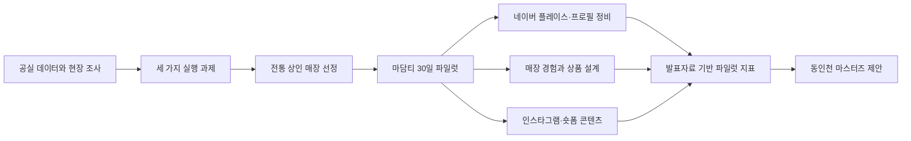

# 동인천 마케팅 파일럿

[English](README.md) · [포트폴리오 케이스 스터디](PORTFOLIO.ko.md)

인천의 2025 PBL(프로젝트 기반 학습) 프로그램에서 대학생 5명(팀명 Sub-Local)이 동인천 구도심 상권을 진단하고, 전통 찻집 ‘마담티’ 한 곳에서 30일 마케팅 파일럿을 실행한 뒤, 이를 상권 전체로 반복하는 모델로 제안한 팀 프로젝트입니다.

**상황:** 발표자료는 동인천·신포·북성동 일대 공실률을 40%(점포 2,612곳 중 1,073곳 공실)로 인용합니다. 출처는 인천시·중구 2020 상권조사를 인용한 연합뉴스입니다.
**실행:** 네이버 플레이스 정비, 인스타그램 채널 개설과 숏폼 콘텐츠, 매장 내 씰링왁스 편지 체험.
**측정된 변화(30일 파일럿, 팀 발표자료 기준, 한 매장, 비교 매장 없음):** 2024년 12월 이후 없던 네이버 리뷰 신규 4건, 평균 월매출 +25%, 2030 신규 방문 +600%(기준 인원수는 남아 있지 않음).

**수상:** 2025 PBL 프로그램 대상(인천광역시장상, 1위), 2026년 2월 27일 수상.
**본인 역할:** 5인 Sub-Local 팀의 Marketing & Data Analysis. [실행 내용과 역할 분담](#실행-내용과-역할-분담) 참고.
**자료 확인:** [최종 발표자료(PDF)](docs/서브로컬팀_PBL_발표자료.pdf) · [결과 슬라이드](images/results.jpg). 실행할 코드는 없습니다.

> **근거 경계:** 이 저장소는 소프트웨어나 예측 모델 프로젝트가 아니라 현장 실행·도시재생 프로젝트입니다. 성과 수치는 한 매장에서 관찰한 전후 비교 결과이며, 원본 POS·채널 로그·비교 매장은 저장소에 포함되어 있지 않습니다.

## 프로젝트 개요

| 항목 | 저장소 근거 |
|---|---|
| 맥락 | 2025 PBL 프로그램 자료와 최종 발표자료(2026년 1월 28일자) |
| 팀 | Sub-Local, 대학생 5명(PM·콘텐츠·행정·마케팅·디자인); 저장소에는 이준형의 역할이 Marketing & Data Analysis로 기록됨 |
| 진단 | 동인천·신포·북성동 2,612개 점포 중 공실 1,073개(약 40%). 발표자료가 인용한 연합뉴스(인천시·중구 2020 상권조사) 수치 |
| 파일럿 | 마담티 대상 30일 리브랜딩·O2O 마케팅 실행 |
| 산출물 | 매장 파일럿 케이스와 동인천 마스터즈 프로그램 제안 |

## 문제와 현장 진단

공실률 수치를 출발점으로 현장 방문과 상인 인터뷰를 진행했고, 다음 세 가지 실행 과제를 정리했습니다.

1. **디지털 단절** — 지도·검색·SNS에서 매장을 발견하기 어려움
2. **첫 방문 매력 부족** — 전통 찻집의 공간과 메뉴가 신규 방문객에게 충분히 전달되지 않음
3. **반복 가능한 홍보 경로 부재** — 자체 채널과 콘텐츠 축적 방식이 없음

공실률은 파일럿보다 약 5년 앞선 2020년 2차 통계이며, 팀이 점포 단위 공실을 새로 집계하지는 않았습니다.


*그림 1. 공실 시각화는 현장 진단의 출발점을 보여 줍니다. 점포 단위 원본 데이터는 저장소에 없습니다.*

## 파일럿 흐름



## 마담티 30일 파일럿

발견, 방문 경험, 공유가 이어지도록 다음 실행을 묶었습니다.

- 네이버 플레이스 정보·사진·메뉴 정비
- `madam_tea` 인스타그램 개설과 스토리텔링 콘텐츠 제작
- ‘시간을 봉인하는 공간’ 콘셉트 및 씰링왁스 편지 체험 도입
- 발표자료 기준 씰링왁스 편지 2,000원, 예약제 티 오마카세 40,000원 제안

## 실행 내용과 역할 분담

- **본인 담당(Marketing & Data Analysis):** 공실·현장 진단, 그리고 네이버 플레이스·인스타그램·숏폼 채널과 콘텐츠 실행
- **팀과 상인:** 프로젝트 관리, 콘텐츠, 행정, 디자인, 공간 경험은 팀 역할이었고 매장 운영은 상인이 맡았습니다. 이를 개인 성과로 주장하지 않습니다.

## 발표자료에 기록된 파일럿 결과

모든 수치는 팀 최종 발표자료의 결과 슬라이드에서 가져왔으며, 30일 파일럿 기간의 매장 운영·방문 기록을 팀이 정리한 것입니다. 정확한 파일럿 날짜와 파일럿 이전 기준값은 저장소에 남아 있지 않습니다.

| 지표 | 기록된 변화 | 비교 기준 | 해석 경계 |
|---|---:|---|---|
| 네이버 리뷰 | 한 달간 신규 4건 | 파일럿 전 마지막 리뷰: 2024년 12월 | 매장 운영 기록이며 기초 활동값이 완전하게 남아 있지 않음 |
| 평균 월매출 | +25% | 프로젝트 이전 월평균 | 전후 비교 관찰값이며 통제된 증분 효과 추정이 아님 |
| 2030 신규 방문 | +600% | 프로젝트 이전 | 발표자료 기록값이며 수집 방식·분모가 저장소에 없음 |


*그림 2. 이 시각화는 발표자료에 기록된 변화 요약입니다. 한 매장, 30일 전후 비교 결과이므로 특정 실행 하나의 인과 효과로 해석하지 않습니다.*

## 정책·확장 가능성의 경계

인천광역시 소상공인 정책 부서에 가능성을 문의하고, 학생 크리에이터와 전통 상인을 연결하는 동인천 마스터즈 모델을 제안했습니다. 이는 정책 채택이나 운영 서비스의 증거가 아니라 초기 정책 적합성 검토입니다.

다음 파일럿에서는 기준 기간·POS 추출 규칙·채널별 로그를 고정하고, 30·60·90일 추적과 비교 매장 또는 단계적 도입을 추가해야 합니다.

## 자료 구성

```text
docs/서브로컬팀_PBL_발표자료.pdf                    # 최종 발표자료
docs/[붙임1]2025년 PBL 프로그램 안내문.pdf          # 프로그램·평가 기준
images/vacancy.jpg                                # 진단 시각화
images/results.jpg                                # 파일럿 결과 시각화
```

## 관련 문서

- [포트폴리오 케이스 스터디](PORTFOLIO.ko.md)
- [프로젝트 리뷰](docs/PROJECT_REVIEW.md)
- [CV 활용 가이드](docs/CV_BULLETS.md)
