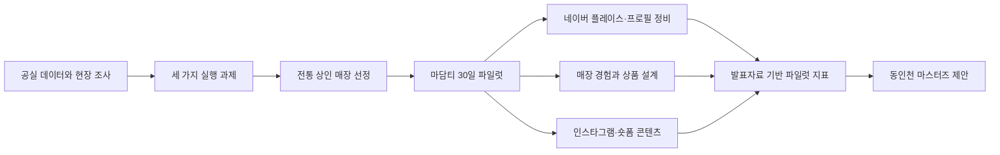

# 동인천 마케팅 파일럿

[English](README.md) · [포트폴리오 케이스 스터디](PORTFOLIO.ko.md)

동인천 구도심 상권 진단을 전통 찻집 '마담티' 한 곳의 30일 마케팅 파일럿으로 실행하고, 이를 상권 전체로 반복하는 모델로 제안합니다. 인천 2025 PBL(프로젝트 기반 학습) 프로그램의 대학생 5인 팀(Sub-Local) 프로젝트입니다.

**상황:** 동인천·신포·북성동 일대 공실률 40%(점포 2,612곳 중 1,073곳 공실; 발표자료가 인용한 연합뉴스, 인천시·중구 2020 상권조사).
**실행:** 네이버 플레이스 정비, 인스타그램 채널 개설과 숏폼 콘텐츠, 매장 내 씰링왁스 편지 체험.
**측정된 변화(30일 파일럿, 한 매장, 팀 발표자료):** 2024년 12월 이후 없던 네이버 리뷰 신규 4건, 평균 월매출 +25%, 2030 신규 방문 +600%.

**수상:** 2025 PBL 프로그램 대상(인천광역시장상, 1위), 2026년 2월 27일 수상.
**역할:** 5인 Sub-Local 팀의 Marketing & Data Analysis.
**자료 확인:** [최종 발표자료(PDF)](docs/서브로컬팀_PBL_발표자료.pdf) · [결과 슬라이드](images/results.jpg). 실행할 코드는 없습니다.

## 프로젝트 개요

| 항목 | 내용 |
|---|---|
| 맥락 | 2025 PBL 프로그램 자료와 최종 발표자료(2026년 1월 28일자) |
| 팀 | Sub-Local, 대학생 5명(PM·콘텐츠·행정·마케팅·디자인) |
| 파일럿 | 마담티 대상 30일 리브랜딩·O2O 마케팅 실행 |
| 산출물 | 매장 파일럿 케이스와 동인천 마스터즈 프로그램 제안 |

## 현장 진단

현장 방문과 상인 인터뷰로 공실률 수치를 세 가지 실행 과제로 바꿨습니다.

1. **디지털 단절** — 지도·검색·SNS에서 매장을 발견하기 어려움
2. **첫 방문 매력 부족** — 전통 찻집의 공간과 메뉴가 신규 방문객에게 충분히 전달되지 않음
3. **반복 가능한 홍보 경로 부재** — 자체 채널과 콘텐츠 축적 방식이 없음


*그림 1. 현장 진단의 출발점이 된 공실 시각화입니다.*

## 파일럿 흐름



## 마담티 30일 파일럿

- 네이버 플레이스 정보·사진·메뉴 정비
- `madam_tea` 인스타그램 개설과 스토리텔링 콘텐츠 제작
- '시간을 봉인하는 공간' 콘셉트와 씰링왁스 편지 체험 도입
- 씰링왁스 편지 2,000원, 예약제 티 오마카세 40,000원 상품 제시

## 역할 분담

- **Marketing & Data Analysis 역할:** 공실·현장 진단, 네이버 플레이스·인스타그램·숏폼 채널과 콘텐츠 실행
- **팀과 상인:** 프로젝트 관리, 콘텐츠, 행정, 디자인, 공간 경험은 팀 역할이었고 매장 운영은 상인이 맡았습니다.

## 파일럿 결과

출처: 매장 운영·방문 기록을 정리한 팀 최종 발표자료의 결과 슬라이드.

| 지표 | 기록된 변화 | 비교 기준 |
|---|---:|---|
| 네이버 리뷰 | 한 달간 신규 4건 | 파일럿 전 마지막 리뷰: 2024년 12월 |
| 평균 월매출 | +25% | 프로젝트 이전 월평균 |
| 2030 신규 방문 | +600% | 프로젝트 이전 |


*그림 2. 발표자료에 기록된 파일럿 변화 요약입니다.*

## 확장

팀은 인천광역시 소상공인 정책 부서에 실현 가능성을 문의하고, 학생과 상인을 연결하는 반복 가능한 매칭 모델을 제안했습니다. 다음 파일럿: 기준값 정의·POS 추출·채널 로그 고정, 30·60·90일 추적, 비교 매장 또는 단계적 도입.

## 한계

- 한 매장의 전후 비교이며 비교 매장이 없습니다. 인과·증분 효과 추정이 아니고, 개별 실행의 효과를 분리할 수 없습니다.
- 정확한 파일럿 날짜, 파일럿 이전 기준값, 원본 POS, 채널 로그는 남아 있지 않으며, +600%의 수집 방식과 분모도 기록되어 있지 않습니다.
- 공실률은 파일럿보다 약 5년 앞선 2020년 2차 통계이며, 팀이 점포를 다시 집계하지 않았습니다.
- 시 문의는 초기 실현 가능성 검토이며, 정책 채택이나 운영 중인 프로그램이 아닙니다.

## 자료 구성

```text
docs/서브로컬팀_PBL_발표자료.pdf                    # 최종 발표자료
docs/[붙임1]2025년 PBL 프로그램 안내문.pdf          # 프로그램·평가 기준
images/vacancy.jpg                                # 진단 시각화
images/results.jpg                                # 파일럿 결과 시각화
```

## 관련 문서

- [포트폴리오 케이스 스터디](PORTFOLIO.ko.md)
- [프로젝트 리뷰](docs/PROJECT_REVIEW.md)
- [CV 활용 가이드](docs/CV_BULLETS.md)
