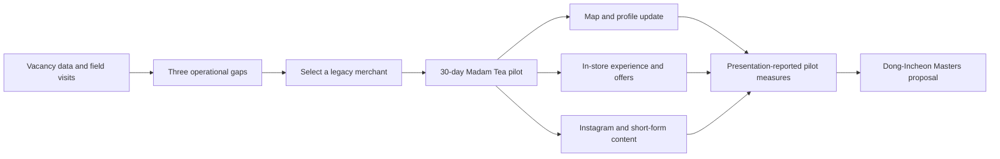

# Dong-Incheon Marketing Pilot

[한국어](README.ko.md) · [Portfolio case study](PORTFOLIO.md)

A five-student team project (team name: Sub-Local) in Incheon's 2025 PBL
(project-based learning) programme that turned a commercial-district diagnosis of
old-downtown Dong-Incheon into a 30-day marketing pilot at one traditional tea
shop, Madam Tea, and a proposal to repeat the model across the district.

**Situation:** the presentation cites a 40% vacancy rate for the
Dong-Incheon, Sinpo, and Bukseong-dong area (1,073 vacant out of 2,612 stores;
Yonhap News, citing the 2020 Incheon/Jung-gu commercial-district survey).
**Intervention:** Naver Place listing, a new Instagram channel and short-form
content, and an in-store sealing-wax letter experience.
**Measured change (30-day pilot, team presentation, one store, no comparison
store):** 4 new Naver reviews after none since Dec 2024, +25% average monthly
sales, +600% new visits from people in their 20s-30s (base counts not retained).

**Recognition:** Grand Prize (Incheon Metropolitan City Mayor Award, first
place), 2025 PBL Programme, awarded 27 Feb 2026.
**My role:** Marketing & Data Analysis in the five-person Sub-Local team;
see [what was done and by whom](#what-was-done-and-by-whom).
**Inspect:** [final presentation (PDF)](docs/서브로컬팀_PBL_발표자료.pdf) · [result slide](images/results.jpg). There is no code to run.

> **Evidence boundary:** this is an urban-regeneration and field-execution
> project, not a software or predictive-model repository. Outcome figures are
> presentation-reported before/after observations from one store; raw POS,
> channel logs, and a comparison store are not included.

## Project overview

| Item | Evidence in this repository |
|---|---|
| Context | 2025 PBL programme materials and final presentation (dated 28 Jan 2026) |
| Team | Sub-Local, five university students (PM, content, admin, marketing, design); the repository records Junhyung Lee as Marketing & Data Analysis |
| Diagnosis | 1,073 vacant stores out of 2,612 in Dong-Incheon, Sinpo, and Bukseong-dong (about 40%), from Yonhap News citing the 2020 Incheon/Jung-gu commercial-district survey, as quoted in the presentation |
| Pilot | 30-day rebranding and O2O marketing execution with Madam Tea |
| Output | Store-pilot case study and a proposed Dong-Incheon Masters programme |

## Problem and field diagnosis

The project treated the vacancy statistic as a starting point, then used field
visits and merchant interviews to turn it into three operational gaps:

1. **Digital disconnection** — limited map, search, and social-media presence.
2. **Weak first-visit appeal** — space and menu information did not make the
   traditional-tea experience legible to a new visitor.
3. **No repeatable promotion path** — no owned channel or content loop for
   attracting and retaining attention.

The vacancy figure is a 2020 secondary statistic, about five years older than
the pilot; the team did not collect a new store-level vacancy count.


*Figure 1. The retained vacancy visual supports the project's field-diagnosis
starting point. The underlying store-level dataset is not included.*

## Pilot flow



## 30-day Madam Tea pilot

The recorded execution connected discovery, experience, and sharing rather
than relying on a single social-media tactic:

- Updated Naver Place information, photos, and menu details.
- Opened the `madam_tea` Instagram channel and produced storytelling assets.
- Framed the store as a place to “seal time” and introduced a sealing-wax
  letter experience.
- Presented a KRW 2,000 sealing-wax-letter offer and a reservation-only
  KRW 40,000 tea-omakase offer in the project materials.

## What was done and by whom

- **My part (Marketing & Data Analysis):** vacancy and field diagnosis, and
  the channel and content execution (Naver Place, Instagram, short-form).
- **Team and merchant:** project management, content, administration, design,
  and the spatial experience were team roles; store operation stayed with the
  merchant. These are not claimed as individual work.

## Reported pilot results

All figures come from the result slide of the team's final presentation,
compiled from store operation and visitor records for the 30-day pilot. The
exact pilot dates and the pre-pilot baseline values are not retained.

| Presentation-reported measure | Reported change | Comparison point | Interpretation boundary |
|---|---:|---|---|
| Naver reviews | 4 new reviews in one month | Last review before the pilot: Dec 2024 | Store-operation record; baseline activity is not fully retained |
| Average monthly sales | +25% | Monthly average before the project | Before/after observation, not a controlled incrementality estimate |
| New visits from people in their 20s–30s | +600% | Before the project | Presentation-reported count change; collection method and denominator are absent |


*Figure 2. The retained result visual summarises the reported pilot changes.
It must be read as a one-store, 30-day before/after record, not causal proof
that any one intervention produced the change.*

## Policy and scaling boundary

The project records a feasibility inquiry with the Incheon Metropolitan City
Small Business Policy Division and proposes a repeatable student-merchant
matching model. This is an exploratory policy-feasibility signal, not a city
adoption commitment or a deployed programme.

For a next pilot, preserve baseline definitions, POS extracts, channel-level
logs, and 30/60/90-day follow-up; add a comparable store or staggered rollout
before claiming causal impact.

## Source materials

```text
docs/서브로컬팀_PBL_발표자료.pdf                    # Final presentation
docs/[붙임1]2025년 PBL 프로그램 안내문.pdf          # Programme/evaluation material
images/vacancy.jpg                                # Retained diagnosis visual
images/results.jpg                                # Retained pilot-result visual
```

## Documentation

- [Portfolio case study](PORTFOLIO.md)
- [Project review](docs/PROJECT_REVIEW.md)
- [CV bullet guidance](docs/CV_BULLETS.md)
