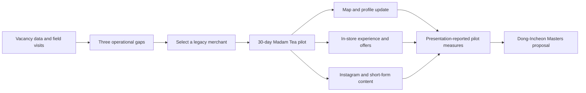

# Dong-Incheon Marketing Pilot

[한국어](README.ko.md) · [Portfolio case study](PORTFOLIO.md)

Turns a commercial-district diagnosis of old-downtown Dong-Incheon into a
30-day marketing pilot at one traditional tea shop, Madam Tea, and a proposal
to repeat the model across the district. Five-student team (Sub-Local) in
Incheon's 2025 PBL (project-based learning) programme.

**Situation:** 40% vacancy in the Dong-Incheon, Sinpo, and Bukseong-dong area
(1,073 vacant out of 2,612 stores; Yonhap News, citing the 2020 Incheon/Jung-gu
commercial-district survey, as quoted in the presentation).
**Intervention:** Naver Place listing, a new Instagram channel and short-form
content, and an in-store sealing-wax letter experience.
**Measured change (30-day pilot, one store, team presentation):** 4 new Naver
reviews after none since Dec 2024, +25% average monthly sales, +600% new visits
from people in their 20s–30s.

**Recognition:** Grand Prize (Incheon Metropolitan City Mayor Award, first
place), 2025 PBL Programme, awarded 27 Feb 2026.
**Role:** Marketing & Data Analysis in the five-person Sub-Local team.
**Inspect:** [final presentation (PDF)](docs/서브로컬팀_PBL_발표자료.pdf) · [result slide](images/results.jpg). There is no code to run.

## Project overview

| Item | Detail |
|---|---|
| Context | 2025 PBL programme materials and final presentation (dated 28 Jan 2026) |
| Team | Sub-Local, five university students (PM, content, admin, marketing, design) |
| Pilot | 30-day rebranding and O2O marketing execution with Madam Tea |
| Output | Store-pilot case study and a proposed Dong-Incheon Masters programme |

## Field diagnosis

Field visits and merchant interviews turn the vacancy statistic into three
operational gaps:

1. **Digital disconnection** — limited map, search, and social-media presence.
2. **Weak first-visit appeal** — space and menu did not make the
   traditional-tea experience legible to a new visitor.
3. **No repeatable promotion path** — no owned channel or content loop.


*Figure 1. Vacancy visual used as the field-diagnosis starting point.*

## Pilot flow



## 30-day Madam Tea pilot

- Updated Naver Place information, photos, and menu details.
- Opened the `madam_tea` Instagram channel and produced storytelling assets.
- Framed the store as a place to "seal time" with a sealing-wax letter
  experience.
- Offered a KRW 2,000 sealing-wax letter and a reservation-only KRW 40,000 tea
  omakase.

## Who did what

- **Marketing & Data Analysis role:** vacancy and field diagnosis, and channel
  and content execution (Naver Place, Instagram, short-form).
- **Team and merchant:** project management, content, administration, design,
  and the spatial experience were team roles; the merchant ran the store.

## Pilot results

Source: result slide of the team's final presentation, compiled from store
operation and visitor records.

| Measure | Reported change | Comparison point |
|---|---:|---|
| Naver reviews | 4 new reviews in one month | Last review before the pilot: Dec 2024 |
| Average monthly sales | +25% | Monthly average before the project |
| New visits from people in their 20s–30s | +600% | Before the project |


*Figure 2. Result slide summarising the reported pilot changes.*

## Scaling

The team ran a feasibility inquiry with the Incheon Metropolitan City Small
Business Policy Division and proposed a repeatable student-merchant matching
model. Next pilot: fixed baseline definitions, POS extracts, and channel logs;
30/60/90-day follow-up; a comparable store or staggered rollout.

## Limitations

- One store, before/after, no comparison store: the changes are not a causal or incremental estimate, and no single intervention's effect can be separated.
- Exact pilot dates, pre-pilot baseline values, raw POS, and channel logs are not retained; the +600% has no recorded collection method or denominator.
- The vacancy figure is a 2020 secondary statistic, about five years older than the pilot; the team did not re-count stores.
- The city inquiry is an exploratory feasibility check, not an adoption commitment or a deployed programme.

## Source materials

```text
docs/서브로컬팀_PBL_발표자료.pdf                    # Final presentation
docs/[붙임1]2025년 PBL 프로그램 안내문.pdf          # Programme/evaluation material
images/vacancy.jpg                                # Diagnosis visual
images/results.jpg                                # Pilot-result visual
```

## Documentation

- [Portfolio case study](PORTFOLIO.md)
- [Project review](docs/PROJECT_REVIEW.md)
- [CV bullet guidance](docs/CV_BULLETS.md)
